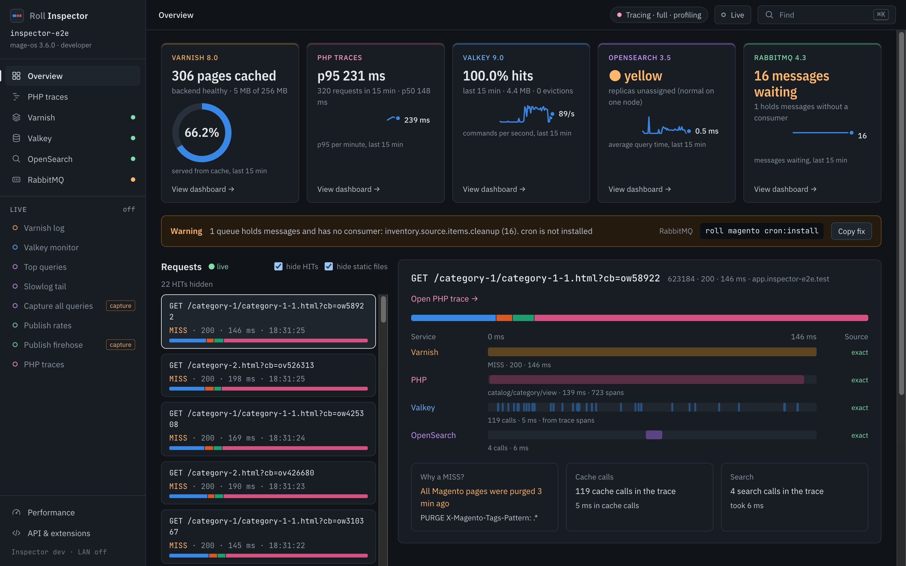

# Roll Inspector

Roll Inspector is a web page per environment that shows what a request did across Varnish, nginx, PHP, Valkey or Redis, RabbitMQ, the database and the search engine. You open it when a page is slow, a cache misses or a queue backs up. It also offers a few write actions, such as purging a Varnish tag.



The Overview shows one card per service, the RabbitMQ no-consumer warning, and the live request list. The cost strip under the selected request splits its time into SQL, cache, search, HTTP and PHP.

The Varnish hit rate is hit / (hit + miss + pass) everywhere: the Health card, the donut, the Overview tile and `/api/v1`. Passes count as requests that were not cacheable, so a shop with many passes shows a lower rate than a hits-against-misses ratio would. The Valkey hit ratio is hits / (hits + misses) with Inspector's own lookups left out, on the Health card, the donut and the Overview tile alike. Each service has one definition. On a service dashboard the KPI follows the window picker and the lifetime ratio sits beside it; the Overview tiles cover the last 15 minutes.

With tracing on, the Valkey lane on the Overview comes from the trace's cache spans, captioned "from trace spans", and Inspector does not run `MONITOR`. It uses `MONITOR` only when tracing is off, or when you start the "Valkey monitor" stream in the live drawer yourself. When the image updates under an open tab, a bar at the top reads "Inspector was updated" with a Reload button.

## Switch it on

Set the toggles in `.env.roll`, then run `roll env up`.

| Key | Default | Notes |
|-----|---------|-------|
| `ROLL_INSPECTOR` | `0` | `1` adds the `inspector` service at `https://inspector.<TRAEFIK_DOMAIN>` |
| `ROLL_INSPECTOR_TRACE` | `0` | `1` loads the tracer in `php-fpm`. Needs `ROLL_INSPECTOR=1`. Cannot be combined with `ROLL_NEWRELIC=1` |
| `ROLL_INSPECTOR_TRACE_DEBUG` | `0` | `1` also traces `php-debug`. Needs `ROLL_INSPECTOR_TRACE=1` |
| `ROLL_INSPECTOR_PROFILE` | `off` | `excimer` adds sampling profiles for the flame graph. Needs `ROLL_INSPECTOR_TRACE=1`, otherwise profiling stays off with a warning |
| `ROLL_INSPECTOR_TRACE_DETAIL` | `full` | `lean` drops the Magento block, event and plugin spans and keeps the request, SQL, cache, HTTP and search spans. Lean traces group under the same route as full traces of that page |
| `ROLL_INSPECTOR_SAMPLE` | `10` | Seconds between metrics samples for the Health dashboards: `10`, `30`, `60` or `off` |
| `ROLL_INSPECTOR_VERSION` | `latest` | Image tag of `inspector` |

A minimal setup that traces every PHP request:

```
ROLL_INSPECTOR=1
ROLL_INSPECTOR_TRACE=1
```

Roll refuses combinations that cannot work. The trace, debug and profile keys error out without `ROLL_INSPECTOR=1`, and `ROLL_INSPECTOR_TRACE` errors out next to `ROLL_NEWRELIC=1`.

## Commands

```
roll inspector            # same as: roll inspector open
roll inspector open
roll inspector status
roll inspector trace on
roll inspector trace off
```

* `open` opens `https://inspector.<TRAEFIK_DOMAIN>` in your browser (`open` on macOS, `xdg-open` on Linux) and prints the URL.
* `status` shows every toggle above except `ROLL_INSPECTOR_VERSION`, the container state and health, and whether your php-fpm image supports tracing and profiling.
* `trace on|off` switches tracing in the running containers and reloads FPM. The change lasts until the php containers restart. `roll env restart php-fpm` returns to the `.env.roll` values.

## Lifecycle

`roll env up` creates a gate secret in `~/.roll/inspector/<env>.secret` (mode 600) the first time `ROLL_INSPECTOR=1` is set. Delete the file and run `roll env up` to get a new one. Inspector refuses to start with a secret shorter than 32 characters.

`roll env down` and a bare `roll env stop` stop Inspector first. That lets it put back any capture it switched on (the OpenSearch slowlog at 0 ms, RabbitMQ tracing) before those services go away. `roll env stop opensearch` (or `elasticsearch`, `rabbitmq`) does the same and starts Inspector again afterwards. Set `ROLL_INSPECTOR=0` and the next `roll env up` or `down` stops and removes the leftover container. `roll env stop` only stops it.

## In this section

```{toctree}
---
maxdepth: 1
---

inspector/how-it-works
inspector/bottlenecks
inspector/services
inspector/performance
inspector/api-and-extensions
inspector/risks-and-troubleshooting
```

* [How it works](inspector/how-it-works.md): the architecture, tracing and profiling, and what each switch turns off.
* [Finding a bottleneck](inspector/bottlenecks.md): a walkthrough from the route list to the slow span, plus keyboard shortcuts.
* [Service dashboards](inspector/services.md): Varnish, Valkey, OpenSearch and RabbitMQ.
* [Performance](inspector/performance.md): what Inspector costs and what to switch off first.
* [API and browser integrations](inspector/api-and-extensions.md): `/api/v1`, the userscript, the DevTools extension and the MCP tools.
* [Accepted risks and troubleshooting](inspector/risks-and-troubleshooting.md).
