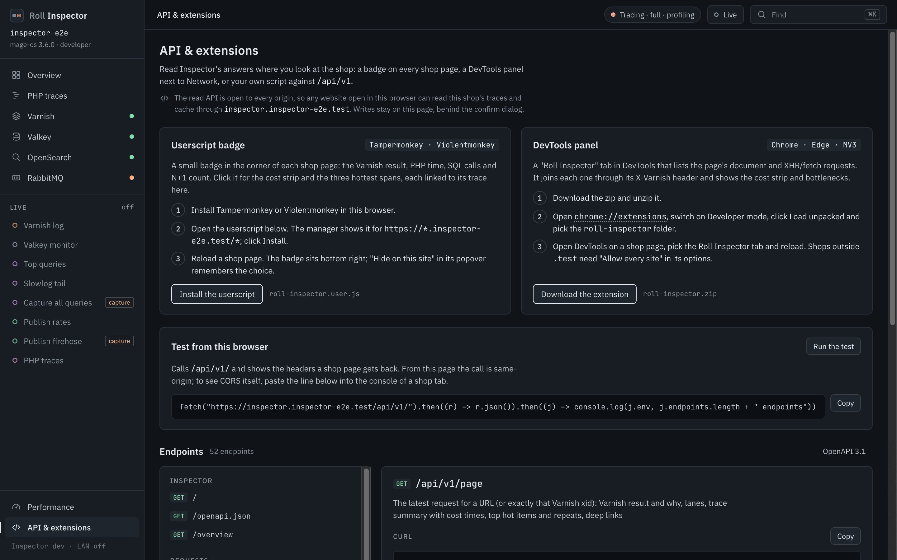
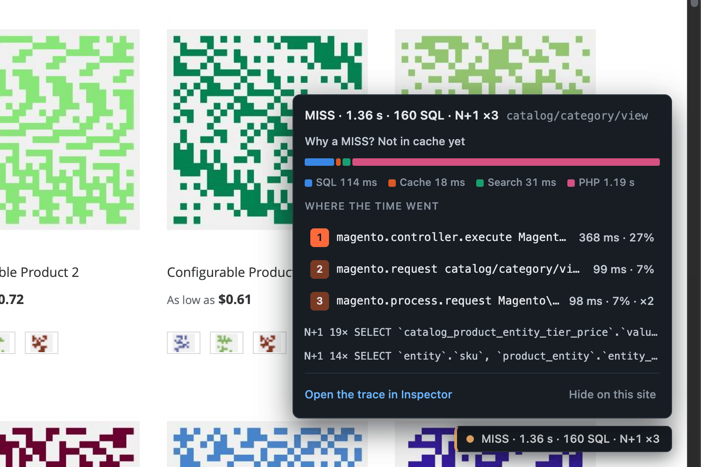
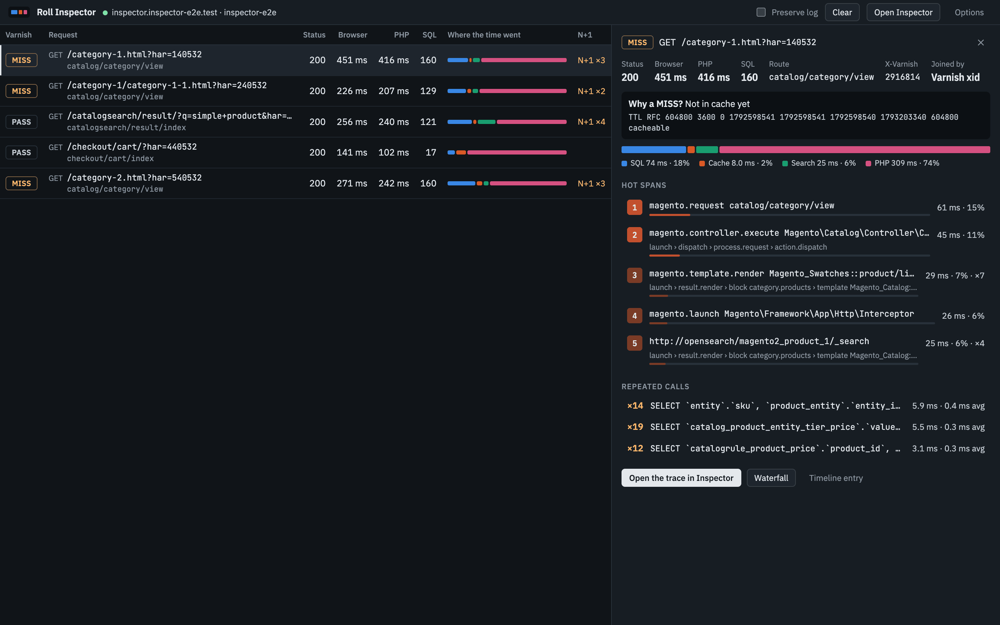

# API and browser integrations

Four clients read the same data as the UI: your own scripts through `/api/v1`, a userscript, a DevTools extension and the rolldev MCP tools. The **API & extensions** page in the rail footer has both installs, a "Test from this browser" check and the endpoint list.



The two install cards sit at the top. The endpoint list below them comes from the running Inspector.

## The API

Everything under `https://inspector.<domain>/api/v1` answers GET, HEAD and OPTIONS with JSON and `Cache-Control: no-store`. Other methods return 405. Errors look like `{error, hint}`. `/api/v1/openapi.json` is an OpenAPI 3.1 description of every route with its query parameters.

Inspector sends `Access-Control-Allow-Origin: *` on `/api/v1` and checks no origin, token or cookie. Any website open in the same browser can therefore read your traces and cache. See [accepted risks](risks-and-troubleshooting.md).

The routes you will use most:

| Route | Returns |
|---|---|
| `/api/v1/` | The env name, domain, version and endpoint list. Use it to confirm which env you reached |
| `/api/v1/page?url=&xid=` | The latest timeline entry for a URL or Varnish xid: HIT, MISS or PASS and why, the lanes, the trace summary, the top hot spans and deep links. 404 with a reason when nothing matches yet. A call starts `varnishlog` for 3 minutes, so a HIT served before the first call is unknown |
| `/api/v1/requests?url=&xid=&limit=` | Recent timeline entries. Starts the same 3-minute `varnishlog` lease |
| `/api/v1/traces?route=&url=&min_ms=&sort=&limit=` | Trace summaries with time per category. `sort` is `slowest` (default) or `recent` |
| `/api/v1/traces/{id}/analysis` | Hot spans, repeated calls and slowest calls. `/api/v1/traces/{id}?spans=1` adds the spans |
| `/api/v1/hotspots` | Routes, operations and repeated calls |
| `/api/v1/overview` | Service health and warnings with copyable fixes |
| `/api/v1/stream?sub=` | Server-sent events for live panels |

With curl, trusting roll's root CA:

```
curl --cacert ~/.roll/ssl/rootca/certs/ca.cert.pem \
  "https://inspector.example.test/api/v1/traces?sort=slowest&limit=5"
```

With `fetch` from any page:

```js
const base = 'https://inspector.example.test/api/v1';
const page = await fetch(`${base}/page?url=${encodeURIComponent(location.href)}`)
  .then(r => r.json());
console.log(page.links.bottlenecks);
```

Streams start work on the shop's services (`MONITOR`, `varnishlog`). The `page` and `requests` routes use a `varnishlog` lease and never `MONITOR`. Each stream accepts only the filters it reads (400 otherwise), `/api/v1` may start at most 2 filtered variants (429 beyond that), and a source stopped on the Performance page answers 409 for 10 minutes. Stop streams when your panel closes. `HEAD /api/v1/stream?sub=` checks a subscription and starts nothing.

To build your own client, see `images/inspector/clients/README.md` in the RollDev repository.

## Userscript

Install Tampermonkey or Violentmonkey, open `https://inspector.<domain>/userscript/roll-inspector.user.js` and click Install. Every shop page then shows a badge at the bottom right.



The badge reads "MISS · 1.36 s · 160 SQL · N+1 ×3": the Varnish result, PHP time, SQL calls and N+1 count. The popover shows the cost strip, the top three hot spans and the repeated calls. Each hot span links to its trace in Inspector. "Hide on this site" is remembered, and the userscript manager's menu brings the badge back.

## DevTools extension

1. Download `https://inspector.<domain>/extension/roll-inspector.zip` and unzip it.
2. In Chrome or Edge open `chrome://extensions` and switch on Developer mode.
3. Click Load unpacked and pick the `roll-inspector` folder.
4. Open DevTools on a shop page and pick the Roll Inspector tab.



The panel lists the page's document and XHR requests, joined to their traces by `X-Varnish`. The detail pane shows why a request was a MISS, its hot spans and its repeated calls.

The extension works on `*.test`. For another domain, use "Allow every site" on the extension's options page. The same page holds a manual Inspector address.

## MCP tools

The rolldev MCP server has six read-only tools: `rolldev_inspector_overview`, `rolldev_inspector_traces`, `rolldev_inspector_trace`, `rolldev_inspector_hotspots`, `rolldev_inspector_request` and `rolldev_inspector_service`. Each takes `project_path`, reads `.env.roll` and calls `https://inspector.<domain>` with roll's root CA. None of them purges, flushes or switches anything.

Example prompt:

> Why is /category-1.html slow? Check the Inspector trace.

Claude finds the request, opens the trace analysis and names the span. Varnish HITs have no trace, so Claude needs a MISS to analyse. See the [MCP server README](https://github.com/dockergiant/rolldev-mcp-server) for setup.
