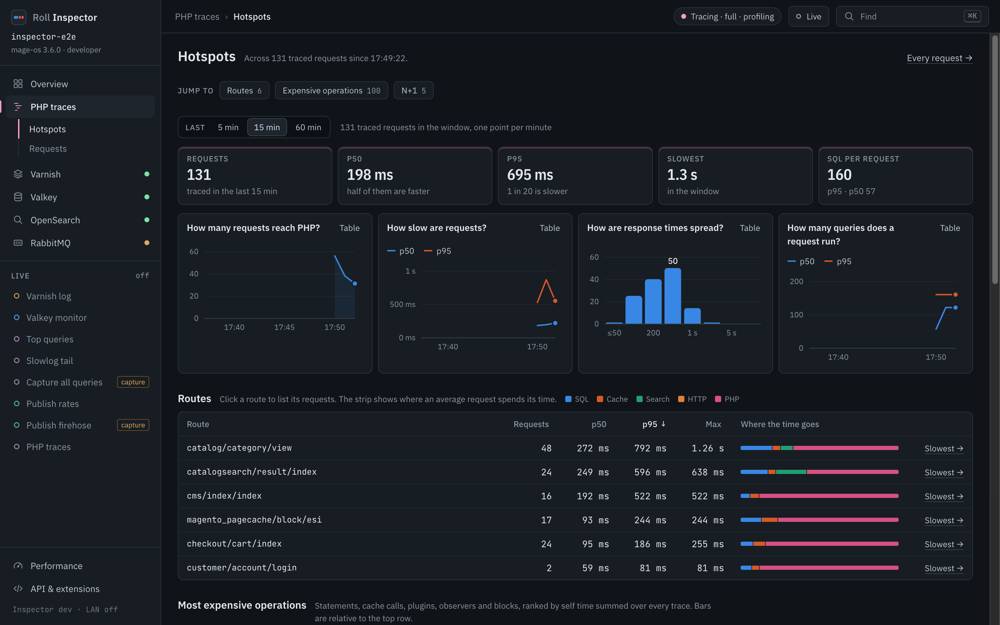
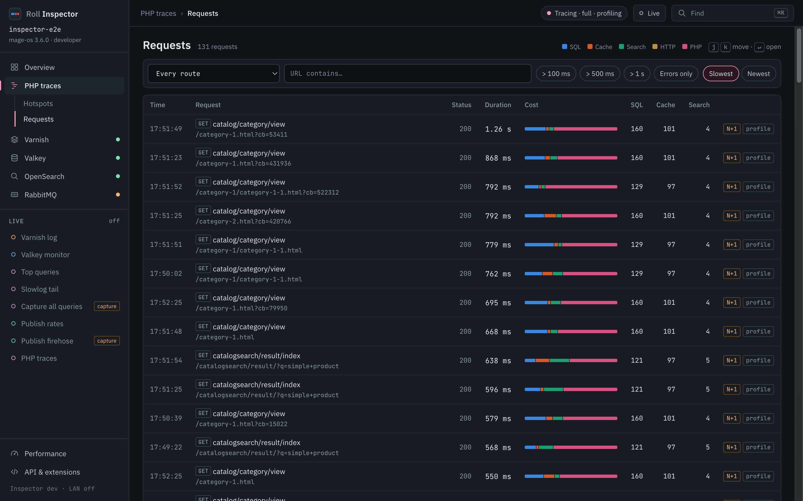
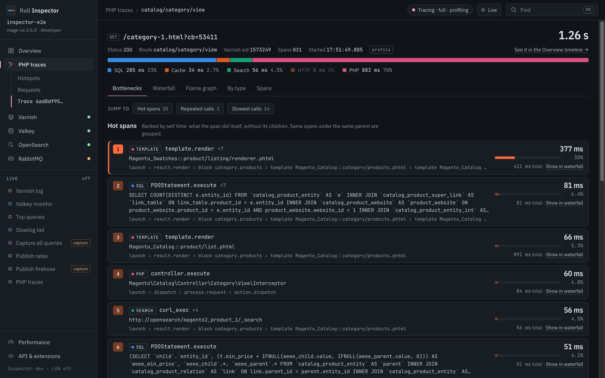
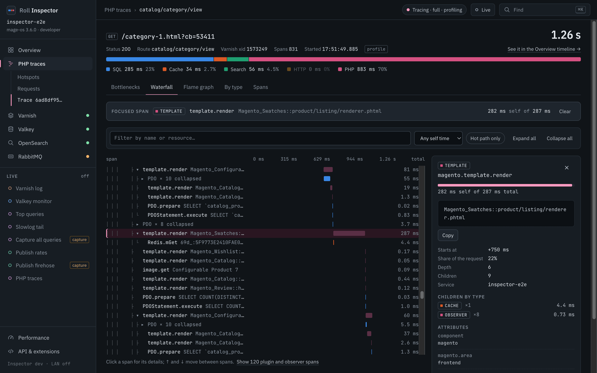
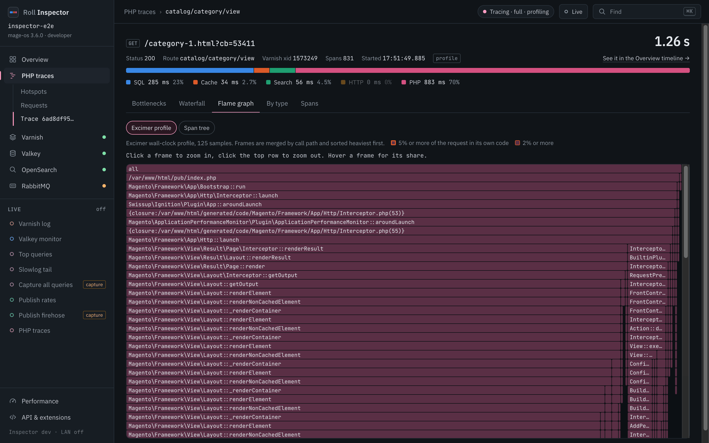
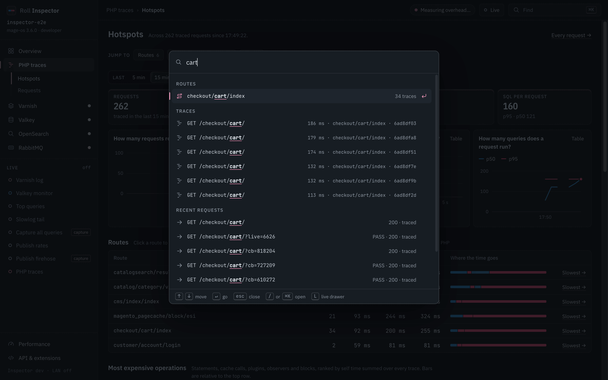

# Finding a bottleneck

This walkthrough follows one slow category page from the route list to the line of code that costs the time. It needs `ROLL_INSPECTOR_TRACE=1`. Varnish HITs have no trace, so load the page with a cache miss (`roll magento cache:clean full_page` forces one).

## 1. Hotspots: which route hurts

Open **PHP traces**. Hotspots ranks routes by p95 and shows requests per minute and p50 and p95 latency above the route table.

Read the route table from the top. The coloured strip on each row splits its time into SQL, cache, search, HTTP and PHP. Below the routes sit the most expensive operations (normalised SQL, cache calls, plugins, blocks, outbound HTTP) and the repeated calls.

## 2. Slowest: which request

Click **Slowest** on a route, or open **Requests** and filter by route, URL, minimum duration or errors.

The list is sorted slowest first. Each row shows its cost bar, SQL and cache counts, and tags such as N+1 and profile.

## 3. Bottlenecks: which span

Click a request. The trace opens on **Bottlenecks**.

Hot spans are ranked by self time, which is the time a span spends outside its children. Each carries its ancestry, so you see which block or plugin called it. Repeated calls and the slowest single calls follow below.

### The cost strip

The strip on every request and trace splits its duration into five categories, always in this order:

| Category | Covers |
|---|---|
| SQL | PDO queries |
| Cache | Valkey or Redis calls |
| Search | OpenSearch calls |
| HTTP | Outbound curl calls |
| PHP | Everything else, including your code and templates |

### N+1

A repeated call is the same normalised statement or cache call running many times in one request, such as one `SELECT` per product in a loop. Rows with repeated calls get an N+1 tag. The Bottlenecks tab lists each one with its count and total time.

## 4. Show in waterfall

**Show in waterfall** on a hot span jumps to the Waterfall tab with that span highlighted and its detail panel open.

The banner above the waterfall names the focused span. The panel on the right shows its tags, such as the template path or the SQL text.

## 5. Flame graph

The **Flame graph** tab draws the Excimer profile. It needs `ROLL_INSPECTOR_PROFILE=excimer`.

Width is wall-clock time across 5 ms samples. PHP frames that spend 5% or more of the request in their own code get a heat outline, and frames at 2% or more a fainter one. Click a frame to zoom in and the top row to zoom out. From the keyboard, Tab puts the focus on the graph, the arrow keys move between frames, and Enter or Space zooms. The Span tree button above the graph swaps the profile for the span tree, which the tab also draws when the trace has no profile.

## Find anything

The command palette finds pages, routes, trace ids, recent request URLs, OpenSearch indices and actions.

Typing `cart` lists the route, matching traces and recent requests. Further down the list, Enter on "Find keys that start with this text" runs a Valkey prefix search.

## Keyboard shortcuts

| Key | Does |
|---|---|
| `Cmd-K`, `Ctrl-K` or `/` | Opens the command palette |
| `j` and `k` | Move down and up through the rows of PHP traces > Requests |
| `Enter` | Opens the focused row |
| `L` | Opens or closes the live drawer |
| `Esc` | Steps back out of a palette mode, then closes the palette, the confirm dialog, the consent dialog of a capture stream or the narrow-screen menu. The live drawer closes with `L` |

Every screen, filter and focused span lives in the URL hash. A link or a reload returns to the same view.
