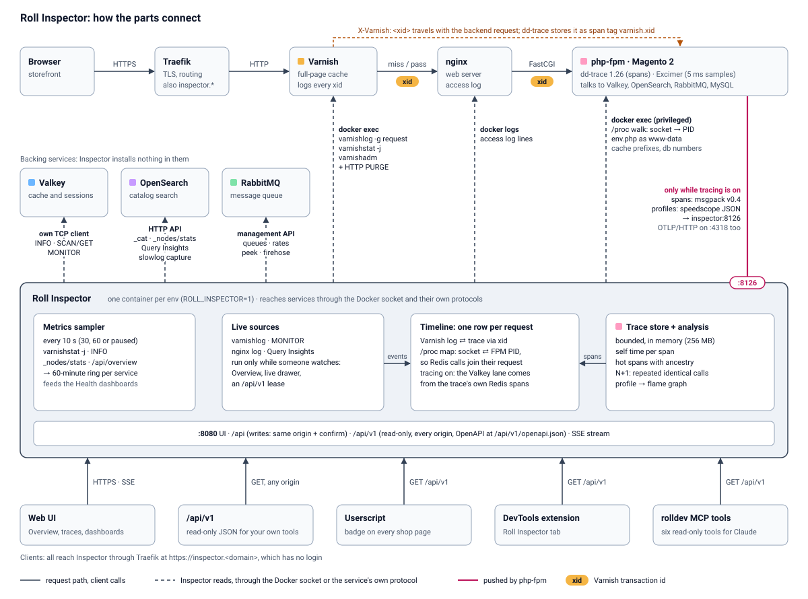
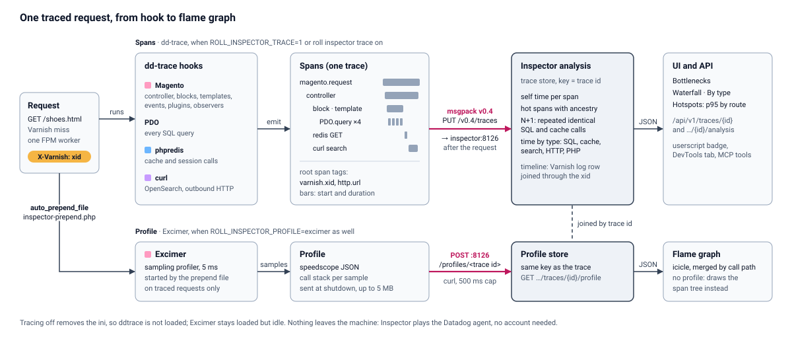

# How Inspector works

The solid arrows are the request path and the client calls. The dashed arrows are what Inspector reads from each service. The pink line is the push of PHP traces into Inspector, and it exists only while tracing is on.

## Inspector reads, services stay untouched

Inspector installs nothing in Varnish, Valkey, OpenSearch, RabbitMQ or nginx. It uses the Docker socket and each service's own protocol:

| Service | How Inspector reads it |
|---|---|
| Varnish | `docker exec` runs `varnishlog -g request`, `varnishstat -j` and `varnishadm`. Purges go out as HTTP `PURGE` |
| Valkey or Redis | Its own TCP client: `INFO`, `SCAN` and `GET` for browsing, `MONITOR` for the live stream, only when tracing is off or you start it |
| OpenSearch | The HTTP API: `_cat`, `_nodes/stats`, Query Insights, and a slowlog capture that sets the threshold to 0 ms and restores it afterwards |
| RabbitMQ | The management API: queues, rates, peek and the firehose |
| nginx | The access log through `docker logs` |
| Magento | A PHP script in php-fpm, run as `www-data`, reads `env.php` for cache frontends, prefixes and database numbers |

Inspector joins these sources into one timeline with one row per request.

* The `X-Varnish` id (xid) joins the Varnish log to the PHP trace exactly. dd-trace stores it as the span tag `varnish.xid`.
* A walk through `/proc` in php-fpm (`internal/procmap`, run as a privileged exec) maps each TCP connection to an FPM worker PID. That is how a Redis call finds the request that made it.
* With tracing on, the Valkey lane comes from the trace's own cache spans and says "from trace spans". Without tracing it falls back to `MONITOR`.
* `/api/v1/page` and `/api/v1/requests` keep `varnishlog` running for 3 minutes after each call (an API lease, never `MONITOR`). A HIT served before the first call stays unknown.

## When things run

| Part | Runs |
|---|---|
| Inspector container | Whenever `ROLL_INSPECTOR=1` |
| Tracing and profiling | Only while switched on |
| Live sources (Varnish log, OpenSearch Query Insights, RabbitMQ rates, Valkey `MONITOR`) | Only while someone watches: the Overview, the live drawer, or an `/api/v1` stream. `MONITOR` runs for the Overview only when tracing is off |
| Metrics sampler for the Health charts | Every 10 s by default. You can set 30 s, 60 s or pause it |

## How tracing works

The top lane shows spans from a request to the UI. The bottom lane shows the profile. A dashed link joins the two by trace id.

dd-trace-php 1.26.0, Datadog's open-source PHP tracer, sits in every php-fpm image and stays off (`98-ddtrace.ini.template`). These three actions turn it on: `ROLL_INSPECTOR_TRACE=1`, `roll inspector trace on`, and the switch on the Performance page. Each runs `roll-inspector-ini on`, which writes `98-ddtrace.ini` and `99-inspector-ddtrace.ini`, plus `99-inspector-profile.ini` when profiling is on. With `ROLL_INSPECTOR_TRACE=1` the container entrypoint runs it before FPM starts. The command and the switch run it in the running container and reload FPM with `USR2`. The ini points the tracer at `http://inspector:8126`, turns telemetry, remote config and code origin off, and copies the `X-Varnish` request header into `varnish.xid`.

Inspector plays the part of the Datadog agent. It accepts msgpack v0.4 traces on port 8126 and OTLP/HTTP on port 4318. You need no Datadog account and nothing leaves your machine. Both ports serve the env's own containers and are not published.

dd-trace instruments Magento controllers, blocks, templates, events, plugins and observers, plus PDO, phpredis and curl (which covers OpenSearch). From the spans Inspector computes self time per span, ranks hot spans, finds repeated calls (N+1), and splits each request into SQL, cache, search, HTTP and PHP.

### Profiling

Excimer, Wikimedia's sampling profiler, starts from `auto_prepend_file` (`inspector-prepend.php`) on traced requests. It samples every 5 ms and posts a speedscope profile to `inspector:8126/profiles/<trace id>`. The flame graph draws from it. Without a profile the flame graph falls back to the span tree.

### What happens when you switch things off

* **Tracing off** removes the ini. The extension is not loaded and costs nothing. Excimer stays loaded but idle, because it only samples when the prepend starts it.
* **Profiling off** leaves traces in place and stops the Excimer sampling.
* **`ROLL_INSPECTOR=0`** means no container, no sampler and no tracing ini.
* **Nobody watching** stops a live source one second after its last viewer leaves.

Varnish HITs never reach PHP, so they have no trace. The Varnish dashboard covers those.

## Supported PHP versions

`images/inspector/scripts/php-matrix` runs a small request through each php-fpm image and checks the spans, the profile and the off state. This table shows what it has verified so far.

| PHP | Tracing | Profiling | php-debug with Xdebug | Notes |
|---|---|---|---|---|
| 7.4 | Verified | Verified | Verified | Needs `datadog.trace.sidecar_trace_sender=1`, which `roll-inspector-ini` sets. Without it dd-trace sends the last trace up to 5 s late. PHP 7.4.33, ddtrace 1.26.0 |
| 8.0 | Verified | Verified | Verified | Bullseye image. Same sidecar setting as 7.4. PHP 8.0.30, ddtrace 1.26.0 |
| 8.1 | Verified | Verified | Verified | Bookworm image, the only tag the mirror has. Same sidecar setting as 7.4. PHP 8.1.33, ddtrace 1.26.0 |
| 8.2 | Verified | Verified | Verified | Same sidecar setting as 7.4. PHP 8.2.29, ddtrace 1.26.0 |
| 8.3 | Verified | Verified | Verified | PHP 8.3.25, ddtrace 1.26.0 |
| 8.4 | Verified | Verified | Verified | PHP 8.4.12, ddtrace 1.26.0 |
| 8.5 | Verified | Verified | Verified | PHP 8.5.0, ddtrace 1.26.0 |
| 8.6 and up | Skipped | Not tested | Not tested | The Dockerfile skips dd-trace from 8.6 (`DD_TRACE_PHP_BELOW`) |

Verified means three requests produced three traces with 57 spans each (PDO 34, Redis 21, curl 1), a speedscope profile for every trace id with `matrix_burn` sampled, a lean run without Magento spans, an off run that posts nothing, and no errors in the php-fpm log. The php-debug column covers the traced and profiled run with Xdebug loaded in `start_with_request=trigger` mode. Lean and off ran on php-fpm only.

Excimer loads in every php-fpm image even before `roll-inspector-ini on`. `on` only enables the prepend that starts the sampling.
