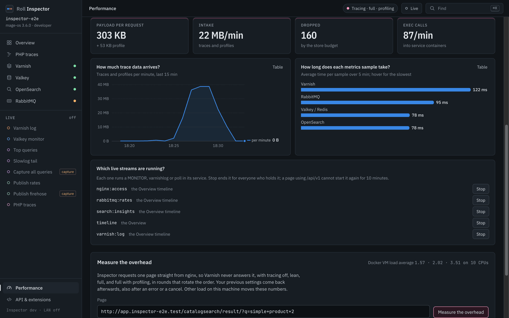

# Performance

Tracing costs the shop CPU time on every request. Inspector also runs commands in your services while you watch them. This page lists what that costs and how to switch it off.

## What it costs

Measured on 2026-10-21 on the `inspector-e2e` env (Mage-OS, 10 CPUs). The machine was busy: the Docker VM load average was 3 to 6. Treat differences under 10 to 20% as noise.

The built-in benchmark ran 5 rounds of 3 requests per setting, twice per URL. Medians in ms, with the difference against off in brackets:

| URL | Run | off | lean | full | full + profile |
|---|---|---|---|---|---|
| `/category-1.html` | 1 | 202 | 244 (+21%) | 210 (+4%) | 240 (+19%) |
| `/category-1.html` | 2 | 246 | 231 (-6%) | 258 (+5%) | 230 (-6%) |
| search `?q=simple+product` | 1 | 176 | 198 (+13%) | 209 (+19%) | 230 (+31%) |
| search `?q=simple+product` | 2 | 206 | 208 (+1%) | 206 (0%) | 299 (+45%) |
| `/` | 1 | 62 | 87 (+39%) | 67 (+7%) | 84 (+35%) |
| `/` | 2 | 69 | 107 (+56%) | 89 (+29%) | 80 (+17%) |

All 360 requests returned 200. The spread inside each setting is as large as the gaps between settings, and the two runs disagree in sign on several.

* Tracing costs about 0 to 30% per request. The fixed few milliseconds weigh most on fast pages: the home page gains 5 to 25 ms.
* Profiling is the most expensive setting on search.
* Lean was not measurably cheaper than full.
* A cross-check with `curl` from the php-fpm container to nginx, 10 rounds per setting on `/category-1.html`, gave 177 ms with tracing off and 180 ms with full tracing and profiling. That is +2%, inside the noise.

The Inspector container itself:

| State | CPU | Memory |
|---|---|---|
| Idle | about 2% of one CPU | 93 to 95 MiB of a 768 MiB limit |
| Overview and Valkey dashboard open | about 2.6% | 94 to 96 MiB |

The metrics sampler at 10 s makes about 100 `exec` calls per minute, and one tick takes 50 to 440 ms. Trace intake at one page per second is about 0.46 MB per trace plus 0.11 MB per profile. The 256 MB trace store then holds about 4 minutes of traffic, and older traces drop out first.

An earlier spike on 2026-10-20, with the host load at 45 to 85, measured FPM worker CPU per category page. ddtrace's default settings cost +36 to +48%. The shipped ini costs +3 to +6%. That is why the ini turns code origin off.

## The Performance page

Open **Performance** in the rail footer (`#/performance`), or click the pill in the top bar.

The cards at the top give the payload per request (303 KB plus a 53 KB profile), the intake per minute, the traces the store dropped and the `exec` calls into service containers. Below them sit the trace data per minute, the time each metrics sample takes per service, and the running live streams, each with its holder and a Stop button. The "Measure the overhead" form at the bottom takes the URL to benchmark.

The switches:

* tracing on or off, separately for `php-fpm` and `php-debug`
* trace detail, `full` or `lean`
* profiling (Excimer) on or off
* metrics sampling every 10, 30 or 60 seconds, or paused
* live sources: every running stream, who holds it (live drawer, Overview or an `/api/v1` page) and a Stop button. A source you stop stays off for `/api/v1` clients for 10 minutes. The Inspector page can start it again.

The PHP switches run `roll-inspector-ini` as root in the container and reload FPM, as `roll inspector trace` does. They last until the php containers restart. The page shows the `.env.roll` value beside each switch and the line that makes a change permanent. The sampling interval lasts until Inspector restarts.

## Measure the overhead

The benchmark requests one URL straight from nginx, so Varnish never answers it. It runs off, lean, full and full with profiling in alternating rounds, with 2 warm-ups and 5 measured rounds per setting. It reports the median and range per setting.

* It puts your previous settings back afterwards, also after an error, a cancel or a SIGTERM. Before the first arm it writes a marker file in the container (`/tmp/roll-inspector-benchmark.json`). If Inspector dies mid-run, the next start reads the marker and restores php-fpm.
* An answer other than 200 stops the run and names the setting.
* A setting your image cannot run, such as lean on an old image, is skipped.
* The page shows the Docker VM load average before and after, and warns above 0.7 per CPU.
* The benchmark's requests are not stored as traces. The Traced requests card counts them as left out.

Run it once on your slowest route. A single run on a loaded machine can show full tracing faster than off. Inspector flags that as noise.

## What to switch off first

When the shop feels slow, work down this list and stop when it feels right:

1. Profiling: `ROLL_INSPECTOR_PROFILE=off`, or the switch on the Performance page.
2. Close the Overview and the dashboards. They keep a Varnish log stream, OpenSearch Query Insights and RabbitMQ rate polling running on the shop's own services. With tracing off they also keep a Valkey `MONITOR` stream.
3. Set sampling to 60 s or pause it.
4. Tracing itself: `roll inspector trace off`, or the switch.
