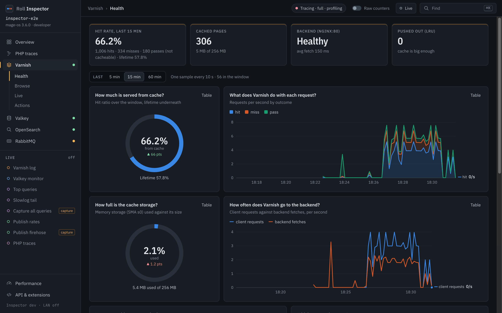
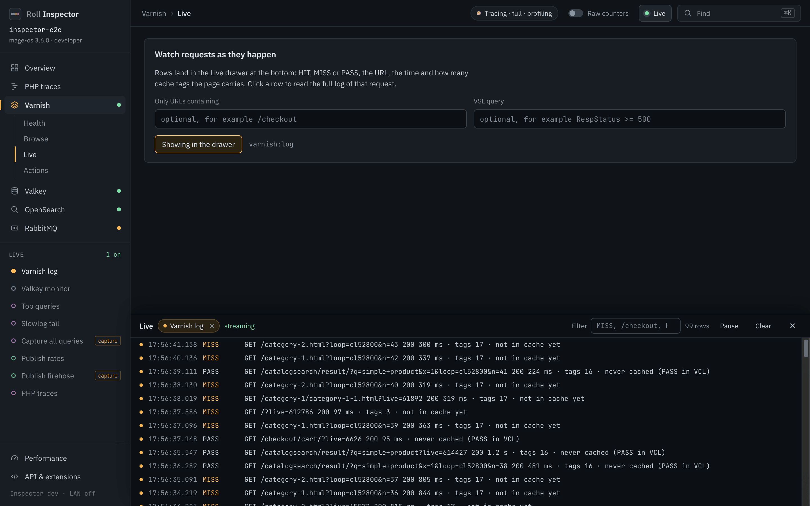
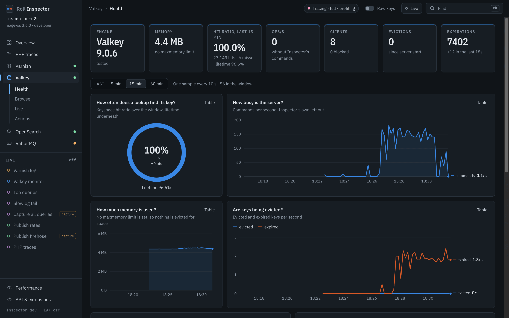
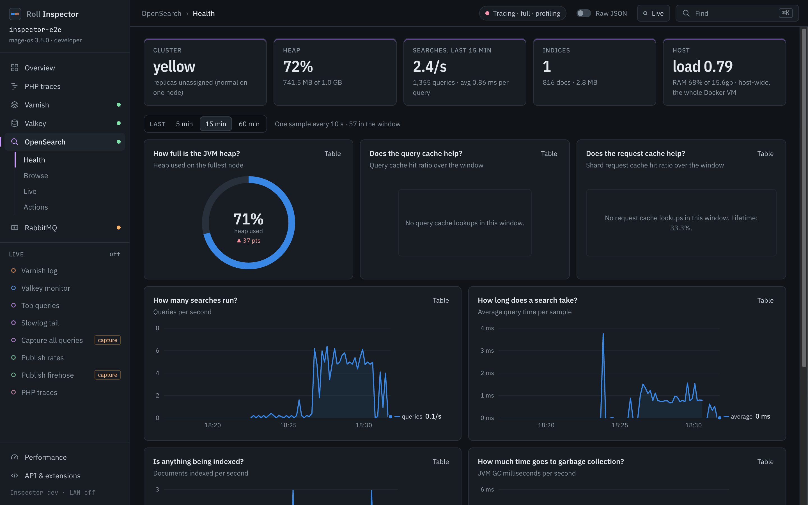
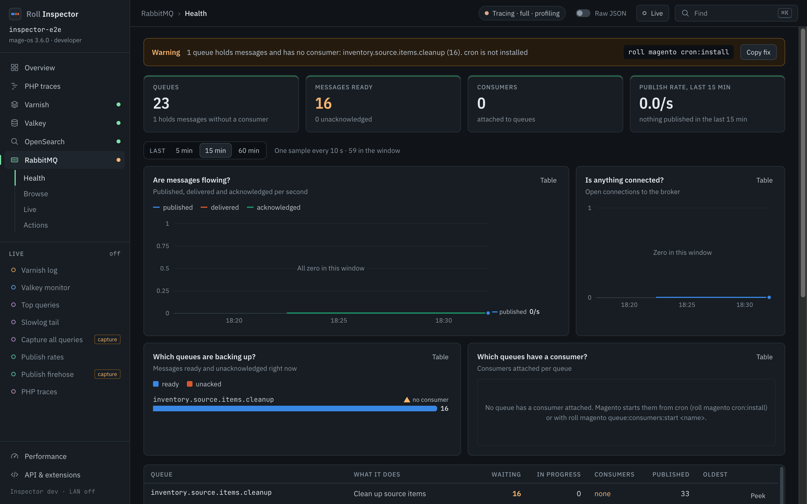
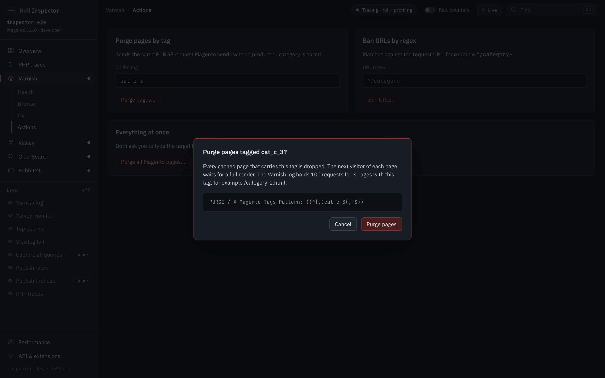

# Service dashboards

The rail on the left lists Overview, PHP traces, Varnish, Valkey, OpenSearch and RabbitMQ, each with a status dot from its health. Below 1100 px the rail shrinks to icons, and below 720 px it opens from a menu button.

Every service page has up to four sections:

* **Health** shows KPIs first, then charts. A window picker (5, 15 or 60 minutes) sits above the charts. A KPI that has a chart below it follows the picker too, so the card and the chart show the same number: the Varnish hit rate, the Valkey hit ratio, OpenSearch searches and the RabbitMQ publish rate. A fresh Inspector shows "Collecting" until it has two samples, and until then the server's own card stands in.
* **Browse** reads the service's state: bans and VCL, cache keys and tags, indices and mappings, queues and consumers.
* **Live** streams events in a drawer at the bottom of any screen. Closing the drawer stops the stream.
* **Actions** changes the service. Each action opens a confirm dialog.

Every chart has a Table toggle for the numbers behind it.

## Varnish

* *How much is served from cache?* A hit-rate donut for the window, with the lifetime rate underneath. The rate is hit / (hit + miss + pass), and passes show as "not cacheable".
* *What does Varnish do with each request?* Hit, miss and pass per second.
* *How full is the cache storage?* Storage used against its size. A Varnish that reports no free space gets *How much cache storage is used?* instead, without a limit.
* *How often does Varnish go to the backend?* Client requests against backend fetches.
* *How many objects are cached?* Objects over time.
* *Which pages miss most?* Ranked URLs from the Varnish log, each with its main reason.
* *Why do objects leave the cache?* Expired and LRU-nuked objects per second.
* *How long is the ban list?* The bans Varnish still tests cached objects against.

The Live section opens the Varnish log in the live drawer, one row per request: the time, HIT, MISS or PASS, the method, URL, status and duration, the number of cache tags, and why the page did not come from cache, such as "not in cache yet", "never cached (PASS in VCL)" or "Cache-Control: private from backend". Click a row to open the whole request record beside the list, with its tags, TTL and raw `varnishlog` lines.

## Valkey

* *How often does a lookup find its key?* The keyspace hit ratio for the window, hits divided by hits plus misses, with the lifetime ratio underneath. Inspector's own reads do not count. The Hit ratio card and the Overview tile divide the same way.
* *How busy is the server?* Commands per second, with Inspector's own left out.
* *How close is memory to the limit?* Memory against `maxmemory`. Without a limit the chart becomes *How much memory is used?* and shows the plain number.
* *Are keys being evicted?* Evicted and expired keys per second.
* *Which cache holds the keys?* Keys per database, labelled with Magento's cache frontends.
* *Which commands run most?* Calls per command in the window, Inspector's own included. The *Where does the server spend its time?* table on the Health page adds the total time per command since the server started.

Browse has the key browser, the tag explorer and a lookup that finds the cache key for a URL. Live streams `MONITOR` with a banner that says it runs. `MONITOR` costs throughput on a busy server, so close the drawer when you finish. With tracing on, the Overview does not run it.

## OpenSearch

* The Cluster card shows the status. Yellow is normal on one node, because replicas have nowhere to go. Inspector says so.
* *How full is the JVM heap?* Heap used on the fullest node, as a ring.
* *Does the query cache help?* and *Does the request cache help?* Hit ratios for the window.
* *How many searches run?* and *How long does a search take?* Queries per second and average query time.
* *Is anything being indexed?* Documents indexed per second.
* *How much time goes to garbage collection?* JVM GC milliseconds per second.
* *Which indices hold the most documents?* and *Which indices take the most disk?* Documents and store size per index.

Browse lists the indices with the Magento store view each one belongs to. It also replays a storefront query against an alias with `profile` and `explain`. Live shows the slowest queries from Query Insights, and can capture every query by lowering the slowlog threshold to 0 ms. Inspector restores the old values when you close the drawer, after 30 minutes, or when it stops.

## RabbitMQ

* *Which queues are backing up?* Ready and unacked messages per queue.
* *Which queues have a consumer?* Consumers per queue. A queue with messages and no consumer raises a banner. Inspector checks the crontab in php-fpm. When none exists, the banner says cron is not installed and offers a **Copy fix** button for `roll magento cron:install`. When it cannot tell, the banner asks "is cron running?" and offers no fix.
* *Are messages flowing?* Publish, deliver and ack rates.
* *Is anything connected?* Open connections to the broker.

Browse lists consumers, topology and a message peek. Peek marks the message as redelivered, so Inspector disables it while a consumer is active. Live offers an opt-in firehose that switches RabbitMQ tracing on and off again.

## Confirm dialog for destructive actions

Purges, bans, deletes and flushes open a confirm dialog. It names the target and previews what will run. The preview for a Varnish tag purge shows the `PURGE` request and its `X-Magento-Tags-Pattern` header. Actions that destroy a lot, such as flushing a database, ask you to type the name first.

Esc cancels the dialog and runs nothing. When Traefik listens beyond loopback, Inspector refuses every write and shows why.
